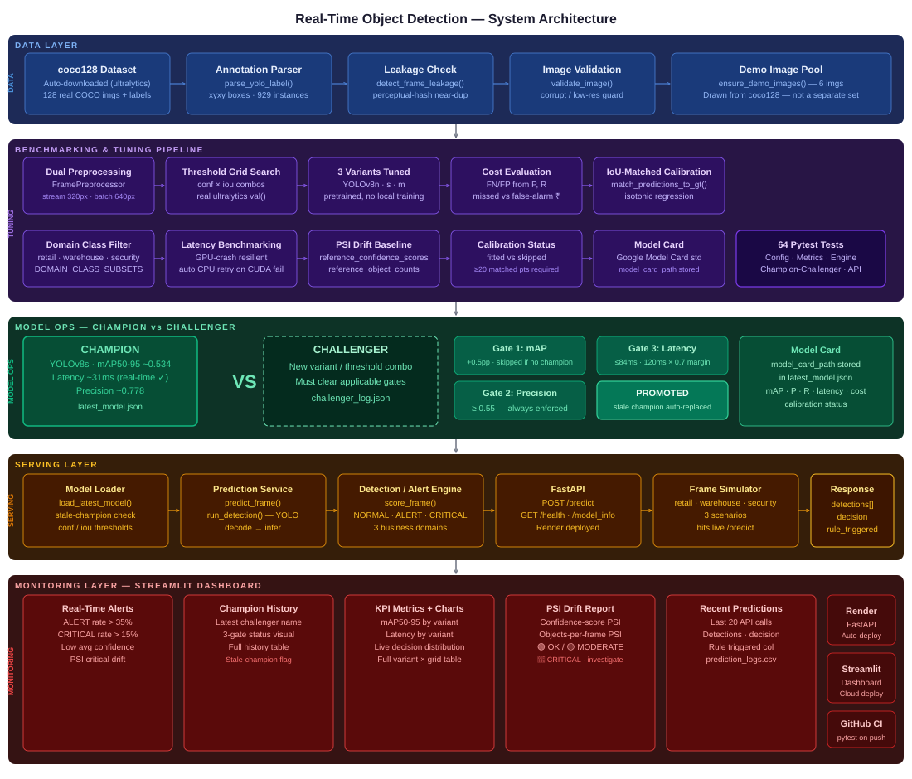
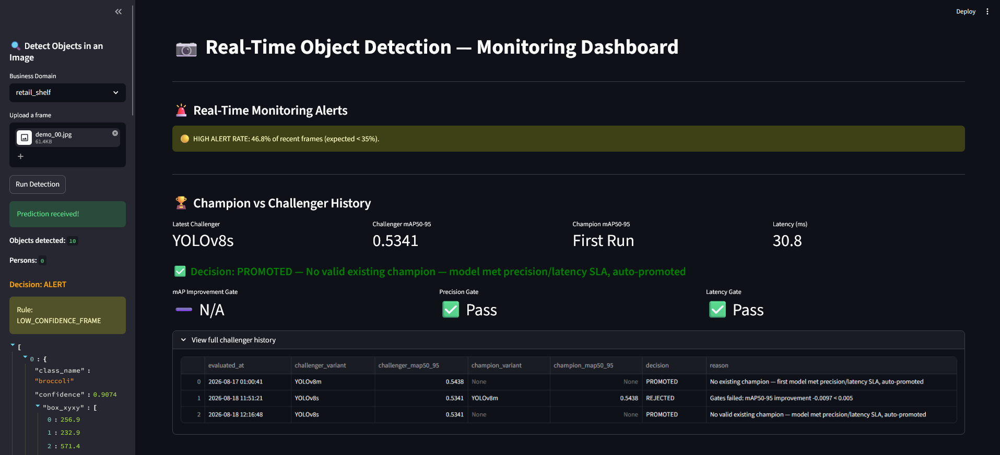
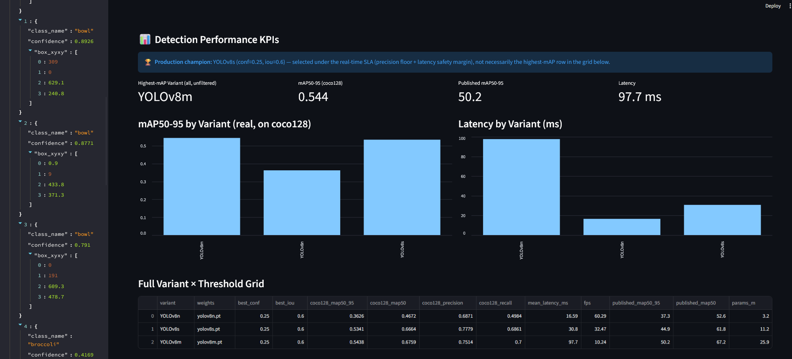
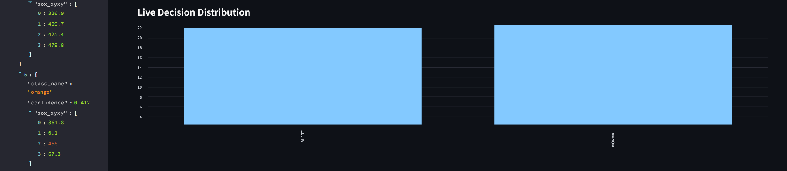
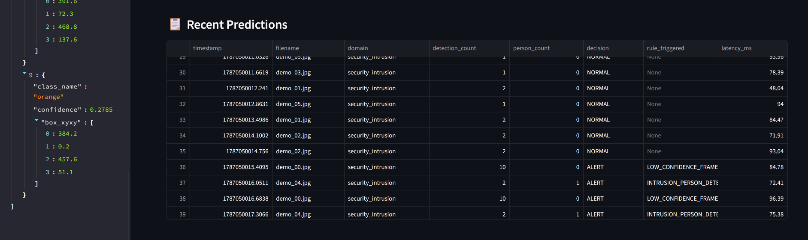
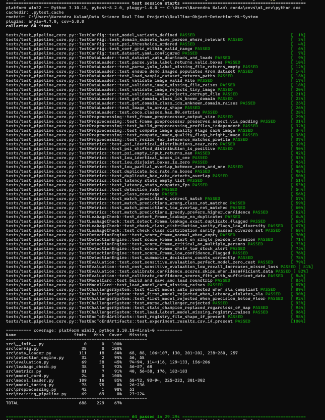
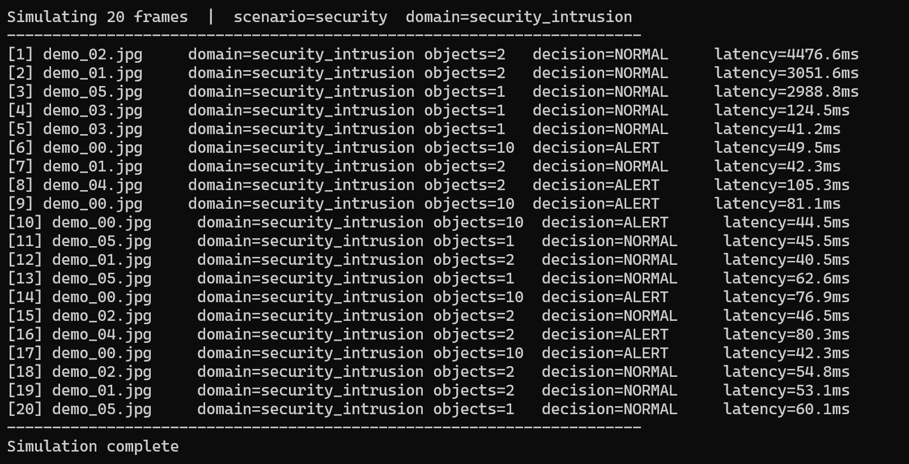
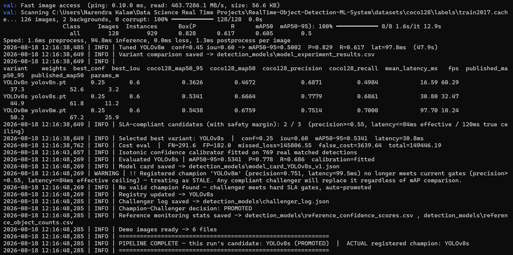
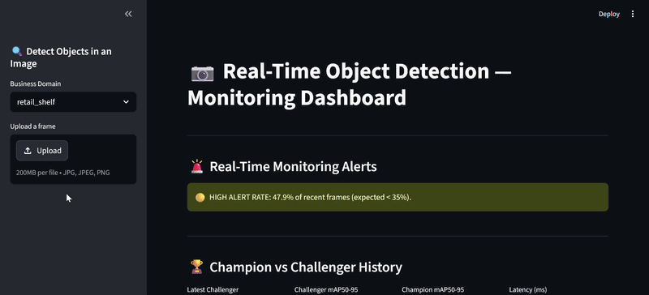

# 📷 Real-Time Object Detection — Retail · Warehouse · Security AI

[](https://github.com/narendrakalam2001/realtime-object-detection-mlops/actions)
[](https://python.org)
[](https://docs.ultralytics.com/models/yolov8/)
[](https://fastapi.tiangolo.com)
[](https://streamlit.io)
[](https://docs.ultralytics.com/models/yolov8/)
[](https://docker.com)
[](tests/test_pipeline_core.py)
[](LICENSE)

> **Domain:** Computer Vision / Retail · Logistics · Security
> **Problem:** Real-time object detection with bounding boxes, wired into a 3-tier business alert engine
> **Dataset:** [coco128 (Ultralytics)](https://docs.ultralytics.com/datasets/detect/coco8/) — a real 128-image subset of COCO train2017, auto-downloaded on first run, real YOLO-format ground truth across all 80 COCO classes
> **Industry Context:** Retail · warehouse logistics · CCTV security — YOLO-based detection powers shelf monitoring, warehouse safety, and intrusion alerts

---

## 💡 Why This Project Matters

Retailers, logistics operators, and security teams don't just run a detector and call it done — they wrap it in business rules that decide what a detection actually *means*: an empty shelf is a restock alert, a person in a restricted zone is an intrusion, three or more people near loading equipment is a safety event. This system simulates that exact production workflow:

- Pretrained **YOLOv8n / YOLOv8s / YOLOv8m** (Ultralytics, trained on COCO train2017) — no local training run required
- A formal **3-gate Champion-Challenger system** promotes a new model only if it clears precision, latency, and (when a valid champion exists) mAP-improvement gates — with a **latency safety margin** built in after real hardware testing showed 40%+ run-to-run variance on the same model
- **Stale-champion detection** — a registered champion that no longer meets today's gates is automatically replaced by any compliant challenger, regardless of mAP, instead of sitting in production indefinitely
- Every detection is scored through a **3-tier alert engine** (`NORMAL` / `ALERT` / `CRITICAL`) across three domains — retail shelf monitoring, warehouse safety, and security intrusion
- Confidence scores are calibrated on **real IoU-matched detections**, not raw model output, and every promotion decision is backed by a **cost-sensitive evaluation** (missed-detection loss vs false-alarm review cost)

This mirrors how real retail and security vision pipelines are structured — pretrained detection first, then rule-based decisioning turns raw boxes into an operational signal.

---

## 🏆 Champion Model Results

Real numbers from `model.val()` against coco128 (128 images, 929 real ground-truth instances) — not a proxy, not simulated.

| Metric | Score |
|---|---|
| **Champion model** | `YOLOv8s` |
| **mAP50-95 (coco128, real)** | `0.5341` |
| **mAP50 (coco128, real)** | `0.6664` |
| **Precision** | `0.7779` |
| **Recall** | `0.6861` |
| **Mean latency (CPU)** | `30.8 ms (~32 FPS)` |
| **Published mAP50-95 (full val2017)** | `44.9` |
| **Confidence / IoU threshold** | `conf=0.25 · iou=0.60` |
| **Calibration** | `Fitted — isotonic regression on 769 real IoU-matched detections` |
| **Promotion decision** | `PROMOTED — replaced a stale YOLOv8m champion` |

---

## 🔗 Live Links

| Service | URL |
|---|---|
| 🚀 **FastAPI (Swagger UI)** | [https://realtime-object-detection-mlops.onrender.com/docs](https://realtime-object-detection-mlops.onrender.com/docs) |
| 📊 **Monitoring Dashboard** | [https://realtime-object-detection-mlops.streamlit.app](https://realtime-object-detection-mlops.streamlit.app) |
| 📓 **EDA Notebook** | [notebooks/Real_Time_Object_Detection_EDA.ipynb](notebooks/Real_Time_Object_Detection_EDA.ipynb) |

> ⚠️ Render free tier: first request may take 30–60 seconds (cold start).

---

## 🏗️ System Architecture



```
╔══════════════════════════════════════════════════════════════════════════════════╗
║        REAL-TIME OBJECT DETECTION — 5-LAYER PRODUCTION SYSTEM                    ║
╠══════════════════════════════════════════════════════════════════════════════════╣
║                                                                                  ║
║  ┌─────────────────────────────── DATA LAYER ──────────────────────────────┐     ║
║  │  coco128 auto-download  →  Annotation Parser  →  Leakage Check          │     ║
║  │  128 real COCO images · 929 ground-truth instances · YOLO-format labels │     ║
║  └───────────────────────────────────┬─────────────────────────────────────┘     ║
║                                      ▼                                           ║
║  ┌─────────────────── BENCHMARKING & TUNING PIPELINE ──────────────────────┐     ║
║  │                                                                         │     ║
║  │  ┌──────────────────┐    ┌───────────────┐    ┌──────────────────────┐  │     ║
║  │  │  Dual             │    │  3 Variants   │    │  Real Evaluation    │  │     ║
║  │  │  Preprocessing    │───▶│  YOLOv8n/s/m  │───▶│  mAP·P·R·latency   │  │     ║
║  │  │  stream · batch   │    │  pretrained   │    │  cost · calibration │  │     ║
║  │  └──────────────────┘    └───────────────┘    └──────────────────────┘  │     ║
║  │                                                                         │     ║
║  │  conf × iou grid search · GPU-crash resilient (auto CPU retry)          │     ║
║  │  CHAMPION → YOLOv8s  mAP50-95=0.5341  latency=30.8ms  P=0.778           │     ║
║  └───────────────────────────────────┬─────────────────────────────────────┘     ║
║                                      ▼                                           ║
║  ┌──────────────────────── CHAMPION-CHALLENGER ────────────────────────────┐     ║
║  │                                                                         │     ║
║  │  Gate 1: mAP improvement   ≥ +0.5pp  → relative, skipped if no champion │     ║
║  │  Gate 2: precision floor   ≥ 0.55    → always enforced                  │     ║
║  │  Gate 3: latency ceiling   ≤ 84ms    → 120ms × 0.70 safety margin       │     ║
║  │                                                                         │     ║
║  │  Stale champion (fails today's gates) → auto-replaced regardless of mAP │     ║
║  │  ALL applicable gates pass → PROMOTED (latest_model.json updated)       │     ║
║  └───────────────────────────────────┬─────────────────────────────────────┘     ║
║                                      ▼                                           ║
║  ┌──────────────────────────── SERVING LAYER ──────────────────────────────┐     ║
║  │                                                                         │     ║
║  │  Model Loader → Prediction Service → Detection / Alert Engine → FastAPI │     ║
║  │                                                                         │     ║
║  │  POST /predict     → upload frame  (→ detections + NORMAL/ALERT/CRIT)   │     ║
║  │  GET  /health       → API health check  (→ {status, model_loaded})      │     ║
║  │  GET  /model_info   → champion registry  (→ variant, thresholds)        │     ║
║  │                                                                         │     ║
║  │  Alert Engine: retail_shelf · warehouse_safety · security_intrusion     │     ║
║  └───────────────────────────────────┬─────────────────────────────────────┘     ║
║                                      ▼                                           ║
║  ┌─────────────────── MONITORING LAYER — STREAMLIT DASHBOARD ──────────────┐     ║
║  │                                                                         │     ║
║  │  Section 1: Real-Time Alerts    → ALERT/CRITICAL rate · PSI critical    │     ║
║  │  Section 2: Champion-Challenger → decision · 3-gate status · history    │     ║
║  │  Section 3: KPIs + Charts       → mAP by variant · latency by variant   │     ║
║  │  Section 4: PSI Drift           → confidence & detection-count PSI      │     ║
║  │  Section 5: Recent Predictions  → last 20 API calls · decisions         │     ║
║  │  Sidebar:   Live Detection      → upload frame → instant detections     │     ║
║  │                                                                         │     ║
║  │  Simulator: 3 scenarios (retail · warehouse · security) → hits /predict │     ║
║  └─────────────────────────────────────────────────────────────────────────┘     ║
╚══════════════════════════════════════════════════════════════════════════════════╝
```

---

## 📸 Dashboard Screenshots

### 🖥️ Full Dashboard UI

Real-time detection dashboard — live sidebar detection · Champion-Challenger system · KPI cards · PSI drift · prediction audit log.



---

### 📊 Detection Performance KPIs

mAP50-95 = 0.5341 (YOLOv8s champion) · full variant × threshold grid · latency-by-variant bar chart with the SLA safety margin applied.



---

### 📉 Confidence & Detection-Count Drift (PSI)

Reference (benchmark-time) confidence distribution vs live production traffic — PSI computed once enough production volume has accumulated.

.png>)

---

### 📈 Live Decision Distribution

Live NORMAL / ALERT / CRITICAL split across recent API predictions.



---

### 📋 Recent Predictions Log

Last 20 API predictions — detections, decision, rule triggered, latency.



---

## 📊 Training Reports

| Test Coverage | Simulation Run |
|---|---|
|  |  |

| Training & Benchmarking Summary |
|---|
|  |

---

## 🎬 System Demo



---

## 📁 Project Structure

```
RealTime-Object-Detection-ML-System/
│
├── src/                                     # Core ML system
│   ├── config.py                            # Model variants, thresholds, domain rules, SLA gates
│   ├── data_loader.py                       # coco128 auto-download · real YOLO-label parsing
│   ├── preprocessing.py                     # Letterbox FramePreprocessor · dual stream/batch profiles
│   ├── leakage_check.py                     # Near-duplicate frame detection (perceptual hash)
│   ├── metrics.py                           # PSI · IoU · latency stats · real IoU-matched scoring
│   ├── model_tuning.py                      # conf × iou grid search · GPU-crash resilient
│   ├── evaluation.py                        # Cost-sensitive eval · isotonic calibration · drift report
│   ├── model_card.py                        # Google Model Card-standard JSON builder
│   ├── model_loader.py                      # Champion-Challenger 3-gate system + stale-champion check
│   ├── detection_engine.py                  # 3-tier NORMAL/ALERT/CRITICAL business rule engine
│   └── training_pipeline.py                 # End-to-end benchmark → evaluate → register pipeline
│
├── serving/
│   └── detection_api.py                     # FastAPI: /predict · /health · /model_info
│
├── services/
│   └── prediction_service.py                # Image → YOLO inference → alert-engine decision
│
├── monitoring/
│   └── monitoring_dashboard.py              # Streamlit: 5-section monitoring dashboard
│
├── simulation/
│   └── frame_simulator.py                   # 3-scenario live-feed simulator (retail·warehouse·security)
│
├── tests/
│   └── test_pipeline_core.py                # 64 pytest unit tests — all passing
│
├── scripts/
│   ├── train_model.py                       # python scripts/train_model.py
│   ├── run_api.py                           # python scripts/run_api.py
│   ├── run_dashboard.py                     # python scripts/run_dashboard.py
│   └── run_simulation.py                    # python scripts/run_simulation.py
│
├── notebooks/
│   ├── Real_Time_Object_Detection_EDA.ipynb           # 21-step EDA + benchmarking notebook
│   └── Real_Time_Object_Detection_EDA.html           
│
├── data/
│   └── demo_images/                         # Auto-populated from coco128 — not a separate dataset
│
├── datasets/
│   └── coco128/                             # Auto-downloaded on first run (gitignored)
│
├── detection_models/                        # Registry + artifacts (generated)
│   ├── latest_model.json                    # Champion model registry
│   ├── challenger_log.json                  # Full Champion-Challenger comparison history
│   ├── model_card_YOLOv8s_v1.json           # Google Model Card JSON
│   ├── model_experiment_results.csv         # Full variant × threshold grid results
│   ├── reference_confidence_scores.csv      # PSI drift baseline — confidence distribution
│   ├── reference_object_counts.csv          # PSI drift baseline — objects-per-frame distribution
│   └── yolov8n.pt / yolov8s.pt / yolov8m.pt # Pretrained weights (gitignored)
│
├── docs/
│   ├── architecture/
│   │   └── object_detection_architecture.svg  # 5-layer system architecture diagram
│   ├── screenshots/
│   │   ├── dashboard_full_ui.png              # Full Streamlit dashboard UI
│   │   ├── detection_performance_kpis.png     # KPI cards + variant/latency charts
│   │   ├── confidence_&_detection_count_drift(psi).png  # PSI drift charts
│   │   ├── live_decision_distribution.png     # NORMAL/ALERT/CRITICAL live split
│   │   └── recent_predictions.png             # Recent predictions audit log
│   ├── reports/
│   │   ├── simulation.png                     # Simulation run terminal output
│   │   ├── test_coverage.png                  # pytest 64/64 coverage report
│   │   └── training_model_summary.png         # Training/benchmarking summary
│   └── gifs/
│       └── system_demo.gif                    # End-to-end system demo
│
├── logs/
│   └── prediction_logs.csv                  # API prediction audit log (auto-generated)
│
├── Dockerfile                                # FastAPI production image
├── Dockerfile.dashboard                      # Streamlit dashboard container
├── docker-compose.yml                        # API + Dashboard (ports 8000 + 8501)
├── .github/workflows/ci.yml                 # GitHub Actions — pytest on every push
├── .gitignore
├── LICENSE                                   # MIT License
├── README.md                                 # This file
├── render.yaml                               # Render.com deployment config
├── requirements.txt                          # Core / training dependencies
├── requirements_api.txt                      # API-only dependencies
└── requirements_dashboard.txt                # Dashboard-only dependencies
```

---

## 🚀 Quickstart

### 1. Clone & Install

```bash
git clone https://github.com/narendrakalam2001/realtime-object-detection-mlops.git
cd realtime-object-detection-mlops
pip install -r requirements.txt
```

### 2. Dataset — Nothing to Download Manually

coco128 (128 real COCO images + real YOLO-format labels) auto-downloads the first time
`scripts/train_model.py`, the EDA notebook, or the test suite touches it (~7MB, one-time).

```
data/
└── demo_images/          # auto-populated from coco128 for quick API/dashboard testing
```

### 3. Benchmark & Register Champion Model

```bash
python scripts/train_model.py
```

Expected output (real run):
```
INFO  Dataset ready | classes=80 train=.../coco128/images/train2017
INFO  coco128 val split: 128 images, 929 ground-truth instances
INFO  Leakage check flagged 5 issue(s) — see logs above
INFO  Tuned YOLOv8n conf=0.25 iou=0.60 -> mAP50-95=0.3626  P=0.687  R=0.498  lat=16.6ms
INFO  Tuned YOLOv8s conf=0.25 iou=0.60 -> mAP50-95=0.5341  P=0.778  R=0.686  lat=30.8ms
INFO  Tuned YOLOv8m conf=0.25 iou=0.60 -> mAP50-95=0.5438  P=0.751  R=0.700  lat=97.7ms
INFO  SLA-compliant candidates (with safety margin): 2 / 3  (precision>=0.55, latency<=84ms)
INFO  Selected best variant: YOLOv8s | mAP50-95=0.5341  latency=30.8ms
INFO  Cost eval | FN~291.6  FP~182.0  total=149446.19
INFO  Isotonic confidence calibrator fitted on 769 real matched detections
INFO  No valid champion found — challenger meets hard SLA gates, auto-promoted
INFO  PIPELINE COMPLETE — ACTUAL registered champion: YOLOv8s
```

> ⏱️ Full grid search (3 variants × 6 threshold combos = 18 real validation passes) takes roughly
> 15–25 minutes on CPU. GPU speeds this up but small-VRAM GPUs (≤2GB) may need the built-in
> CUDA-crash-recovery retry logic — see `src/model_tuning.py`.

### 4. Start API

```bash
python scripts/run_api.py
# API:  http://localhost:8000
# Docs: http://localhost:8000/docs
```

### 5. Start Dashboard

```bash
python scripts/run_dashboard.py
# Dashboard: http://localhost:8501
```

### 6. Run Simulation

```bash
python scripts/run_simulation.py
# cycles through demo frames against the live API across 3 domains
```

### 7. Run Tests

```bash
pytest tests/ -v
# 64 passed (2 more auto-run once detection_models/ artifacts exist)
```

---

## 🐳 Docker

```bash
# Start everything
docker compose up --build

# API only
docker compose up api

# Dashboard only
docker compose up dashboard

# Stop
docker compose down
```

| Service | URL |
|---|---|
| FastAPI + Swagger | `http://localhost:8000/docs` |
| Streamlit Dashboard | `http://localhost:8501` |

---

## 🌐 API Reference

### POST /predict — Single Frame Detection

```bash
curl -X POST "http://localhost:8000/predict?domain=security_intrusion" \
  -F "file=@data/demo_images/demo_00.jpg"
```

**Response (real schema, illustrative values):**
```json
{
  "detections": [
    {"class_name": "person", "confidence": 0.91, "box_xyxy": [15.4, 229.4, 805.0, 748.4]},
    {"class_name": "person", "confidence": 0.87, "box_xyxy": [220.1, 405.6, 340.7, 748.9]},
    {"class_name": "bus", "confidence": 0.94, "box_xyxy": [22.9, 230.7, 805.6, 750.3]}
  ],
  "detection_count": 5,
  "domain": "security_intrusion",
  "decision": "CRITICAL",
  "rule_triggered": "INTRUSION_MULTIPLE_PERSONS",
  "person_count": 4,
  "latency_ms": 34.2,
  "image_size": [810, 1080]
}
```

### GET /health

```json
{"status": "running", "model_loaded": true}
```

### GET /model_info

```json
{
  "variant": "YOLOv8s",
  "weights": "yolov8s.pt",
  "conf_threshold": 0.25,
  "iou_threshold": 0.6,
  "model_card_path": "detection_models/model_card_YOLOv8s_v1.json"
}
```

---

## 📊 All 3 Variants — Comparison Table

Real numbers from `model.val()` against coco128 (real ground truth, not simulated):

| Variant | Params | mAP50-95 (coco128) | Precision | Recall | Latency (CPU) | Published mAP50-95 (val2017) | SLA-compliant? |
|---|---|---|---|---|---|---|---|
| YOLOv8n | 3.2M | 0.3626 | 0.687 | 0.498 | 16.6ms | 37.3 | ✅ Yes |
| **YOLOv8s** ⭐ | 11.2M | **0.5341** | **0.778** | 0.686 | **30.8ms** | 44.9 | ✅ Yes — **Champion** |
| YOLOv8m | 25.9M | 0.5438 | 0.751 | 0.700 | 97.7ms | 50.2 | ❌ No — exceeds 84ms effective ceiling |

> YOLOv8m scores the highest raw mAP but is excluded from champion selection — its 97.7ms latency
> clears the *true* 120ms SLA but not the *effective* 84ms ceiling used for candidate selection
> (see safety margin below). "Real-time" is treated as a non-negotiable product requirement, not
> a number to optimize around.

---

## 🏆 Champion vs Challenger — 3-Gate Promotion

Every new model/threshold configuration is compared against the current production champion using **3 promotion gates**, all computed from real `model.val()` metrics on coco128:

| Gate | Condition | Applies to first model? |
|---|---|---|
| mAP Improvement | Challenger must beat champion mAP50-95 by ≥ 0.005 | ❌ Skipped — nothing to compare against |
| Precision Floor | ≥ 0.55 | ✅ Always enforced |
| Latency Safety Ceiling | ≤ 84ms (120ms true SLA × 0.70 safety margin) | ✅ Always enforced |

> **Why a safety margin?** Real hardware testing showed the *same* model + config vary 40%+ in
> measured latency between benchmark sessions — thermal throttling, laptop power plan, driver
> state. A candidate that only barely clears the true 120ms ceiling in one benchmark run isn't
> reliably real-time in production, so candidate selection filters against the stricter effective
> ceiling instead of trusting a single measurement.

**Real run — stale champion detected and replaced:**

```
CHAMPION vs CHALLENGER
  Champion  : YOLOv8m    mAP50-95=0.5438
  Challenger: YOLOv8s    mAP50-95=0.5341
!! Registered champion 'YOLOv8m' (precision=0.751, latency=99.5ms) no longer meets
   current gates (precision>=0.55, latency<=84ms effective ceiling) — treating as STALE.
No valid champion found — challenger meets hard SLA gates, auto-promoted
Registry updated -> YOLOv8s
PIPELINE COMPLETE — ACTUAL registered champion: YOLOv8s
```

> A champion promoted under looser rules doesn't get to keep its spot indefinitely just because
> no newer candidate happened to beat its mAP — if it no longer clears today's gates, it's treated
> exactly like "no champion exists," and any compliant challenger replaces it.

Results logged to `detection_models/challenger_log.json` and visible in the dashboard Section 2 with per-gate ✅/❌ status.

---

## 🧠 Business Alert Engine — 3-Tier Decision System

| Domain | Rule | Trigger | Decision |
|---|---|---|---|
| `security_intrusion` | `INTRUSION_PERSON_DETECTED` | ≥1 person in a restricted-zone frame | 🟡 ALERT |
| `security_intrusion` | `INTRUSION_MULTIPLE_PERSONS` | ≥3 persons in a restricted-zone frame | 🔴 CRITICAL |
| `warehouse_safety` | `PERSON_NEAR_VEHICLE` | Person detected near a truck | 🟡 ALERT |
| `warehouse_safety` | `WAREHOUSE_CROWDING` | ≥4 persons near equipment | 🔴 CRITICAL |
| `retail_shelf` | `SHELF_LOW_STOCK` | ≤1 relevant retail item detected | 🟡 ALERT |
| Any domain | `LOW_CONFIDENCE_FRAME` | ≥35% of detections below 0.4 confidence | 🟡 ALERT |
| Any domain | *(none of the above)* | — | 🟢 NORMAL |

Results logged to `logs/prediction_logs.csv` and visible in the dashboard Section 5 with rule-triggered and latency per prediction.

---

## 📈 Monitoring Dashboard — 5 Sections

| Section | What it shows |
|---|---|
| **1. Real-Time Alerts** | ALERT rate > 35% · CRITICAL rate > 15% · low avg confidence · PSI critical drift |
| **2. Champion-Challenger** | Latest decision badge · 3-gate pass/fail status · full history table |
| **3. KPIs + Charts** | mAP50-95 by variant · latency by variant · live decision distribution · full grid table |
| **4. PSI Drift** | Reference vs live confidence distribution · objects-per-frame PSI |
| **5. Recent Predictions** | Last 20 API calls · detections · decision · rule triggered |
| **Sidebar** | Live detection — upload a frame → instant detections + decision |

---

## 🧪 Test Coverage

```
64 tests collected across 10 test classes:

  TestConfig            (5)  — model variants · domain subsets · PSI thresholds · conf grid · dataset config
  TestDataLoader        (13) — auto-download · YOLO-label parsing · demo images · image validation ·
                                domain class ids · COCO class map (80 entries)
  TestPreprocessing     (6)  — letterbox output size · aspect-preserving padding · dual profiles ·
                                image-quality dark/bright flags · resize-for-inference
  TestMetrics           (16) — PSI stable/shifted/empty · IoU identical/disjoint/partial ·
                                duplicate-box rate · latency stats · detection rate · class coverage ·
                                real IoU-matched prediction scoring (4 tests)
  TestLeakageCheck      (4)  — no-duplicates pass · exact-duplicate flagged · class-diversity checks
  TestDetectionEngine   (6)  — NORMAL/ALERT/CRITICAL per domain · low-confidence flag · decision summary
  TestEvaluation        (4)  — cost-sensitive eval (perfect + low-recall) · calibration fit/skip
  TestModelCard         (2)  — build/save/load round-trip · missing-card raises
  TestChallengerSystem  (6)  — first-model promotion/rejection · worse-challenger rejection ·
                                stale-champion replacement · missing-registry raises
  TestEndToEndArtifacts (2)  — registry shape · experiment-results CSV shape (skip until pipeline runs)

Result: 64 passed (0 failed)
```


---

## 🧠 Technical Standards

| Component | Implementation |
|---|---|
| **Models** | YOLOv8n / YOLOv8s / YOLOv8m — Ultralytics, pretrained on COCO train2017, no local training |
| **Dataset** | coco128 — auto-downloaded, real images + real YOLO-format ground truth |
| **Preprocessing** | Letterbox `FramePreprocessor` — dual stream (320px) / batch (640px) resolution profiles |
| **Threshold Tuning** | conf × iou grid search via ultralytics `model.val()` — real forward passes, not proxies |
| **Leakage Detection** | Perceptual average-hash near-duplicate frame check before any benchmarking |
| **Confidence Calibration** | Isotonic regression on real IoU-matched detections (`match_predictions_to_ground_truth`) |
| **Cost-Sensitive Evaluation** | Missed-detection loss vs false-alarm review cost, from real precision/recall |
| **Champion-Challenger** | 3-gate: mAP improvement (relative) · precision floor · latency safety-margined ceiling |
| **Stale-Champion Detection** | Registered champion re-validated against current gates on every run |
| **GPU Resilience** | Automatic CPU retry + memory cleanup on CUDA failure during grid search |
| **Model Card** | Google Model Cards standard — JSON with metrics, dataset notes, calibration status |
| **Alert Engine** | 3-tier NORMAL/ALERT/CRITICAL business rules across 3 domains |
| **CI/CD** | GitHub Actions — pytest on every push |
| **Deployment** | Render.com (FastAPI) + Streamlit Cloud (Dashboard) |

---

## 📊 Business Impact

Real cost-sensitive evaluation output from the actual benchmark run (coco128, 929 ground-truth instances, YOLOv8s champion config):

| Metric | Value |
|---|---|
| Estimated true positives | `~638` |
| Estimated false negatives (missed detections) | `~291.6` |
| Estimated false positives (false alarms) | `~182.0` |
| Missed-detection cost (₹500/event) | `₹145,806.55` |
| False-alarm review cost (₹20/event) | `₹3,639.64` |
| **Total estimated cost (this benchmark)** | **`₹149,446.19`** |
| Champion inference speed | `~32 FPS (CPU)` — real-time capable |

> Cost weights (`missed_detection_cost=₹500`, `false_alarm_cost=₹20`) are configurable in
> `src/evaluation.py::cost_sensitive_evaluation` — tune them to reflect the actual operational
> cost of a missed intrusion/defect vs analyst review time for a specific deployment.

---

## 🛡️ Ethical & Practical Considerations

- coco128 is a 128-image **sanity-check subset**, not the full 5,000-image COCO val2017 split — its mAP reads lower/noisier than the officially published val2017 benchmark, and both are reported side-by-side in every model card rather than one being hidden
- Threshold tuning and champion selection are only as good as the benchmark set — supplement with real domain-camera footage (actual retail aisles, warehouse floors, security feeds) before a production launch decision
- The alert engine's thresholds (`INTRUSION_CRITICAL_COUNT=3`, `WAREHOUSE_CROWD_THRESHOLD=4`, etc.) are starting points in `src/config.py` — calibrate them against the target camera's real field of view and typical foot traffic
- Latency benchmarks are hardware-dependent — the 84ms effective SLA ceiling reflects safety-margined testing on a 2GB-VRAM laptop GPU; re-benchmark on actual deployment hardware before trusting the champion selection
- This system detects and classifies objects — it does not perform re-identification or tracking across frames; a person counted in frame N and frame N+1 may be double-counted as two separate "detections" in aggregate stats

---

## 👨‍💻 About

**Narendra Kalam** — MSc Computer Science (Gold Medalist — NASSCOM, Full Stack Data Science + AI)

> Building 30+ industry-level, end-to-end ML systems across all domains.

[](https://www.linkedin.com/in/narendra-kalam)
[](https://www.kaggle.com/narendrakalam)
[](https://narendrakalam2001.github.io)
[](mailto:kalamnarendra2001@gmail.com)

### Portfolio Projects

| # | Project | Domain | Champion Model | Key Metric |
|---|---|---|---|---|
| 1 | Credit Card Fraud Detection | BFSI / Fintech | ExtraTrees | F1 = 0.8962 · 284K transactions |
| 2 | Credit Risk Prediction | BFSI / Lending | LightGBM | F1 = 0.9741 · ROC-AUC = 0.9991 |
| 3 | Customer Churn Prediction | Telecom / BFSI | CatBoost | F1 = 0.634 · Recall = 0.7312 |
| 4 | House Price Prediction | Real Estate | CatBoost | RMSE = $20,128 · R² = 0.9053 |
| 5 | Store Sales Forecasting | Retail / Supply Chain | LightGBM (Ensemble) | RMSLE = 0.3739 · R² = 0.9761 |
| 6 | Energy Demand Forecasting | Energy / Utilities | ElasticNet | RMSE = 712.04 MW · R² = 0.9759 |
| 7 | Stock Price & Risk Forecasting | Fintech / Capital Markets | Ridge | DirAcc = 53.44% · Sharpe = 0.80 |
| 8 | Resume Screener AI | HR Tech | LightGBM | F1 = 0.7608 · Top-3 = 0.9416 |
| 9 | ABSA Sentiment Analysis | E-Commerce / Banking | RidgeClassifier | Macro-F1 = 0.6212 · ROC-AUC = 0.823 |
| 10 | Fake News Detector | Media Tech / Gov Tech | XGBoost | F1 = 0.9993 · ROC = 1.0000 |
| 11 | BC5CDR Clinical NER | Biomedical NLP | BioBERT | F1 = 0.8847 · Chemical F1 = 0.9239 |
| 12 | News Topic Modeling | Media Analytics | LDA (Gensim) | Cv = 0.6225 · Diversity = 0.92 |
| 13 | Chest X-Ray Diagnosis | Healthcare AI | DenseNet121 | Mean AUC = 0.7864 · 14 classes |
| 14 | **Real-Time Object Detection** | **Computer Vision / Retail-Security** | **YOLOv8s** | **mAP50-95 = 0.5341 · 32 FPS** |
| 15 | Face Emotion Recognition | EdTech / Retail CX | CNN-from-scratch | Macro-F1 = 0.5950 · 7 classes |
| 16 | Customer Segmentation Engine | E-Commerce / BFSI | DBSCAN (Unsupervised) | Silhouette = 0.4056 |
| 17 | Market Basket Analysis (Instacart) | Retail / Quick-Commerce | Apriori | 68,820 rules · mean lift = 15.66 |
| 18 | E-Commerce / OTT Recommender | E-Commerce / Streaming | Hybrid (SVD + Content) | NDCG@10 = 0.0407 · 4 candidates |
| 19 | Hospital Readmission Prediction | Healthcare / Hospital Ops | ExtraTrees | F1 = 0.2702 · ROC-AUC = 0.6513 |
| 20 | HR Policy Intelligence Chatbot | HR Tech / Enterprise GenAI | Gemini 3.6 Flash + RAG | 30/30 tests · guardrail threshold=0.35 |
| 21 | Employee Attrition Prediction | HR Tech / People Analytics | NeuralNet (MLP) | F1 = 0.3902 · ROC-AUC = 0.6698 |
| 22 | ANN From Scratch — MNIST Digit Recognizer | Deep Learning Fundamentals | From-scratch ANN | Test Acc = 0.9740 · Macro F1 = 0.9739 |
| 23 | Insurance Premium Prediction | Insurance / Actuarial ML | RandomForest | RMSLE = 1.1586 · 1.2M real policies |
| 24 | Health Insurance Cross-Sell | Insurance / BFSI | ExtraTrees | ROC-AUC = 0.8404 · 67.8% calls saved |
| 25 | Ride Fare Price Prediction | Mobility / Ride-Hailing | LightGBM | RMSE = $3.81 · R² = 0.8419 · 55M rows |
| 26 | E-Commerce BI & SQL Analytics | Retail Analytics / BI | SQL + FastAPI + Streamlit | 40 tests passing · 100K orders |
| 27 | AgriSense AI | AgriTech | EfficientNetB3 | Accuracy = 98.44% · Macro-F1 = 0.9843 · 38 classes |
| 28 | AI Loan Underwriting Platform | BFSI / Fintech | XGBoost (credit + fraud) | Credit ROC-AUC = 0.858 · Fraud ROC-AUC = 0.955 · 242 tests |
| 29 | CineMatch Pro | Entertainment / Media Tech | Hybrid SVD + TF-IDF + SBERT · CLIP · RoBERTa | RMSE = 0.8005 · Sentiment Acc = 94.26% · 56K posters |
| 30 | DriveGuard AI | Computer Vision / Smart Cities | YOLOv8m + DeepSORT + Gemini RAG | mAP@0.5 = 0.680 · 31 API routes · 364 tests |
| 31 | MathVision AI | EdTech / Computer Vision | TrOCR-large + SymPy | CER = 0.138 · 350/350 symbolic solved |

---

## 📚 References

- Jocher, Chaurasia, Qiu (2023) — [Ultralytics YOLOv8](https://docs.ultralytics.com/models/yolov8/)
- Lin et al. (2014) — [Microsoft COCO: Common Objects in Context](https://arxiv.org/abs/1405.0312)
- coco128 — [Ultralytics COCO8/128 Documentation](https://docs.ultralytics.com/datasets/detect/coco8/)
- Zadrozny & Elkan (2002) — [Transforming Classifier Scores into Accurate Multiclass Probability Estimates](https://dl.acm.org/doi/10.1145/775047.775151) *(isotonic calibration)*

---

## 📄 License

This project is licensed under the MIT License — see the [LICENSE](LICENSE) file for details.